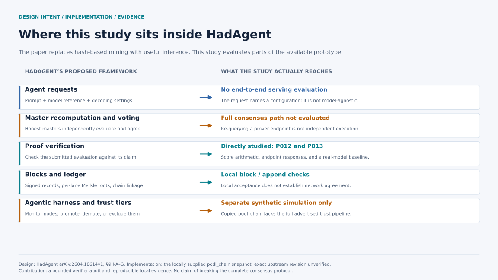
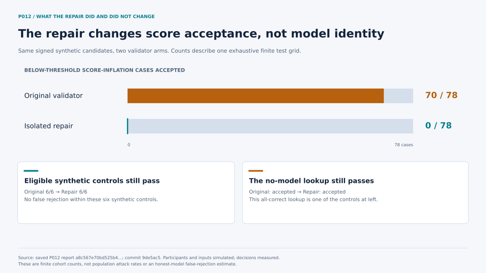
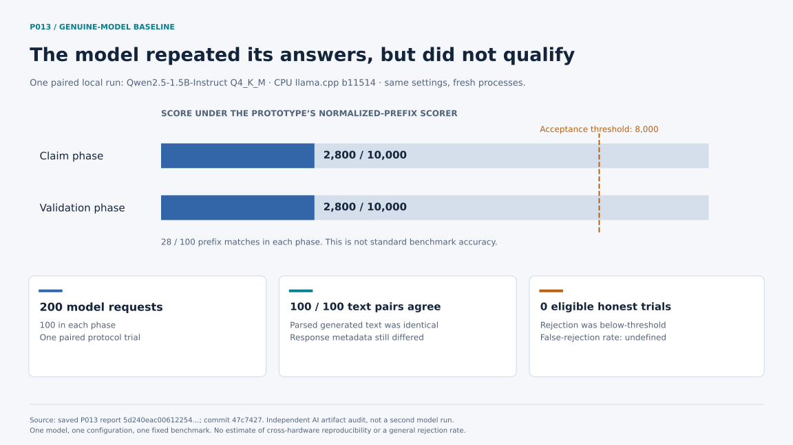
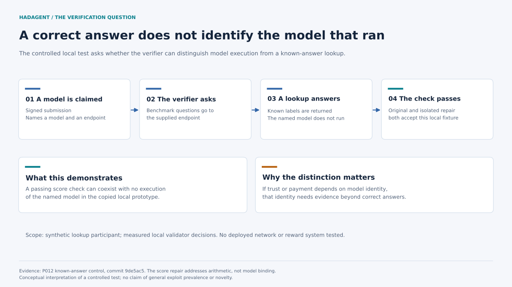

# HadAgent Verification Study

This repository is a local verification study of code copied from the HadAgent research prototype. It tests what the snapshot actually validates at its block, proof, ledger, and loopback-network boundaries. It also preserves earlier synthetic red-team demonstrations, clearly separated from measured experiments.

The strongest result is a score-unit defect in the copied block validator. A signed proof chooses `score_scale`, the verifier computes a score in those declared units, and `Block.validate` compares the result with the fixed integer threshold `8000`. In the preregistered finite grid, the original path accepted 70 of 78 constructed below-threshold cases; an isolated fixed-scale repair accepted 0 of 78 and retained all 6 eligible synthetic controls. These are measured validator decisions over synthetic fixtures, not a field exploit rate.

This study does **not** establish a break of the complete protocol described in the [HadAgent paper, sections III-A through III-G](https://arxiv.org/html/2604.18614v1#S3). The paper specifies fixed model weights, inputs, and decoding, plus independent recomputation by master nodes. The copied prototype instead queries the endpoint named in the signed proof and does not load the committed model artifact during verification. That is an implementation-to-design gap in this snapshot. Matching an output also does not prove that the prover performed fresh physical computation; cached answers can be output-equivalent.



*The completed work reaches the local proof, block, ledger, and record-transport boundaries. It does not reach the paper's complete master-voting, trust, serving, or reward system.*

## Results at a glance

| Study | Evidence | Result | Boundary |
|---|---|---|---|
| [P012 score-scale grid](docs/P012_SCORE_SCALE_GRID_RESULTS.md) | Measured validator decisions; synthetic participants and labels | Original accepted 70/78 constructed below-threshold cases; repair accepted 0/78; both retained 6/6 eligible controls | Local copied `Block.validate`; no model, peer, chain, or reward path |
| [P010 known-answer participant](docs/P010_LOCAL_REDTEAM_RESULTS.md) | Real signatures, local HTTP, saved benchmark; constructed participant | Original and repaired score paths both accepted correct known answers without running the named model | Known public benchmark; does not test hidden challenges or independent masters |
| [P013 honest baseline](docs/HONEST_BASELINE_RESULTS.md) | 200 real local model requests across two fresh server processes | Both phases scored 28/100 and generated identical text for 100/100 prompts; the truthful block was correctly rejected below the 8000 threshold | Zero eligible honest acceptance trials, so false rejection is undefined |
| [Local ledger and peer boundary](docs/LOCAL_LEDGER_PEER_RESULTS.md) | Real signatures, local file-backed ledger, loopback TCP | Height and prior-hash checks worked; inconsistent MODEL/PROOF metadata could coexist; `BLOCK_ANNOUNCE` was unhandled | Local append and record transport, not distributed consensus |
| Earlier runner demonstrations | Deterministic synthetic fixtures | Exercise trust, safety, model-binding, determinism, and a historical tuple-validation bug | Illustrative simulations; do not treat their rates as model or deployment measurements |

The P012 primary and clean-checkout reproduction agreed on all 220 decisions. The P013 saved-artifact audit found no discrepancy but did not rerun the model. Both were designed, implemented, executed, and reviewed with AI agents under Matthew Ngoy's direction; they are not independent human validation.





## What the copied prototype verifies

The vendored snapshot under `hadagent/src/podl_chain/` validates record schemas and signatures, block linkage fields and lane roots, a producer signature, the local evaluation-set hash, a fixed decoding hash, a claimed score, and a fixed threshold. Its PoDL evaluator sends prompts to the proof's endpoint. It does not cross-link MODEL and PROOF metadata or independently load the model artifact. See [Scope and claims](docs/SCOPE_AND_CLAIMS.md) for exact functions and the comparison with the paper's intended design.



The `core/poi/` package is a separate project simulation used by older runners. Its trust manager, two-tier serving path, anomaly detector, and defenses are not copied HadAgent components. Results from those runners must not be presented as measurements of the HadAgent implementation.

The pre-HadAgent LLM/VLM harness is preserved separately in [Vaunty/legacy-red-team-harness](https://github.com/Vaunty/legacy-red-team-harness).

## Repository map

```text
hadagent/src/podl_chain/       copied HadAgent prototype snapshot under study
hadagent/tests/                tests for that copied snapshot
experiments/score_scale_grid/  P012 finite score-scale experiment
experiments/honest_baseline/   P013 two-phase real-model baseline
experiments/local_redteam/     P010, HTTP-extension, and ledger/peer runners
experiments/honest_agreement/  P005 calibration harness and preserved failed run
core/poi/                      separate simulation used by earlier demonstrations
runners/                       earlier synthetic red-team demonstrations
tests/                         combined regression and experiment tests
docs/                          preregistrations, result records, and claim boundaries
```

Generated evidence, model weights, runtimes, local evaluation copies, and private review archives are intentionally excluded from Git. The tracked result documents include hashes and locators for the retained evidence.

## Install and test

Python 3.10 or later is recommended. The current release was tested on Windows with Python 3.14.

```powershell
python -m venv .venv
.venv\Scripts\Activate.ps1
python -m pip install -r requirements-dev.txt
$env:PYTHONPATH = "hadagent/src"
python -m pytest -q
```

The test suite uses local fixtures and loopback services. It does not download a model, call a paid API, or reproduce the measured inference experiments. A judge API key is optional and is used only by an explicitly selected legacy safety-judge demonstration.

The P012 finite grid is the included, no-model experiment. It uses synthetic labels, local signatures, and an owned loopback participant; the validator decisions are measured:

```powershell
$env:PYTHONPATH = "hadagent/src"
python -m experiments.score_scale_grid.run `
  --output experiments/score_scale_grid/local/public-release-check
```

The runner refuses a dirty worktree or a reused output directory. It makes no external requests and writes its evidence under the ignored `local/` directory.

The experiment commands and evidence requirements differ by study. Read [Application guide](docs/APPLICATION_GUIDE.md) and the corresponding preregistration before executing one. The P012 fixtures are synthetic and inexpensive. The P010 and P013 measured configurations require separately obtained pinned local assets and can consume substantial CPU time.

## Evidence labels

- **Measured** means code executed and the saved result records an observed decision, request, timing, or test outcome.
- **Synthetic** means the input, participant behavior, model output, or score was constructed for a controlled test.
- **Real-model local** means the recorded run used the named local model and runtime. It does not imply a deployed network result.
- **AI reproduced or audited** means a separate AI run or artifact check agreed. It is not human replication.

Each result document states which labels apply. Test pass counts are engineering evidence and are not experimental sample sizes.

The [figure notes and source data](docs/assets/README.md) explain how the four diagrams were derived from saved aggregates.

## Attribution, license, and responsible use

This project is independent research by Matthew Ngoy under faculty mentorship from Dr. Boyang Li. AI agents contributed substantial experiment design, implementation, execution, review, and documentation. The exact role is recorded in each result document.

The repository includes a copied HadAgent research snapshot and a judge adapted from DebateCoach. Their exact source revisions and reuse licenses were not recorded with the copy. No repository-wide license grant is currently provided. Public access permits inspection but does not by itself grant reuse rights. See [NOTICE](NOTICE.md) before redistributing code.

Run the harness only against systems and endpoints you own or are authorized to test. The included experiments default to local fixtures and loopback services.
