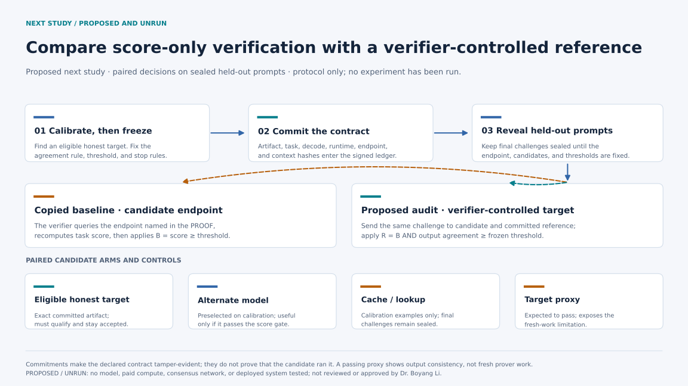

# Proposed next study: verifier-controlled reference audit

> **Status (October 14, 2026): proposed and unrun.** No model experiment, paid compute, or network trial has started. Dr. Boyang Li has not reviewed or approved this protocol. This page is a study design, not a result or a change to HadAgent.

## Research question

Under a frozen exact-model contract, does comparing candidate outputs with a verifier-controlled instance of the committed model reject score-qualifying substitutions more often than the copied score-only rule, while continuing to accept an eligible honest target at a predeclared operating point?

The copied `verify_podl_llm_eval` path checks the provider, evaluation-set hash, fixed decoding hash, endpoint responses, claimed score, and threshold. It sends prompts to the endpoint named in the signed PROOF record. It does not load the artifact named by the model fields or compare the endpoint's output with a separate execution of that artifact. The [HadAgent paper](https://arxiv.org/html/2604.18614v1#S3) describes fixed weights, inputs, and decoding plus independent master recomputation. This proposed experiment tests that implementation-to-design gap in the copied snapshot; it does not test the complete consensus protocol.

## Proposed protocol

1. **Establish an eligible honest target during calibration.** The exact committed artifact must pass the existing score threshold before it can serve as a positive control. P013's truthful 28/100 target did not qualify under the frozen 80/100 rule, so it cannot fill this role.
2. **Freeze the contract before held-out testing.** Record the target artifact hash, runtime or container, task and evaluation-set hash, decoding configuration, endpoint, random seed, output-agreement rule, threshold, practical-effect criterion, compute cap, and stop rules.
3. **Commit the frozen fields.** Signed records or a ledger commitment can make the declared artifact, task, configuration, endpoint, and job context tamper-evident. A commitment authenticates the declaration; it does not establish that the candidate executed the committed artifact.
4. **Seal the final challenges.** Keep held-out prompts unavailable until the endpoint, candidate implementations, thresholds, and analysis code are frozen. A leak invalidates the run and requires a genuinely new split.
5. **Run paired decisions on the same saved outputs.** Preserve the copied baseline rule, `B(candidate) = task_score(candidate) >= protocol_threshold`. Compare it with `R(candidate) = B(candidate) AND reference_agreement(candidate, committed_target) >= agreement_threshold`. The reference must be controlled by the verifier rather than routed through the candidate's endpoint.
6. **Report accuracy and cost together.** For each candidate, report the full acceptance table under `B` and `R`, honest false rejection, per-item agreement, candidate and verifier calls, latency, token counts, and available CPU, GPU, memory, and transfer costs. Calibration results stay separate from held-out results.

## Candidate arms and controls

| Arm | Purpose | Required interpretation |
| --- | --- | --- |
| Eligible honest target and repeat | Measures benign disagreement and false rejection for the exact committed artifact. | It must qualify under the frozen score rule; otherwise stop or preregister a new target/task pairing. |
| Preselected alternate model | Tests whether the reference rule detects a model substitution. | It is informative only if it first passes the copied score-only baseline. Select and freeze it using calibration data. |
| Calibration-only cache or lookup | Tests whether sealed challenges add protection beyond a public static benchmark. | The cache may contain calibration examples but must not receive held-out prompts before commitment. |
| Proxy to the correct target | States the boundary of output comparison. | It should pass if it returns the committed target's outputs. Passing cannot show which participant performed the work. |

Retain malformed-signature, wrong-evaluation-hash, wrong-decode-hash, and below-threshold controls so that a wiring failure cannot look like model discrimination.

## Claim ceiling

Even a positive result would support only a conditional local statement: in the frozen copied validator and predeclared tested conditions, a verifier-controlled output-consistency rule detected the specified score-qualifying substitutions with measured honest-rejection and compute costs.

It would not prove fresh physical computation, execution by the rewarded node, resistance to a proxy that calls the correct target, current-upstream behavior, majority consensus, finality, reward impact, or deployed harm. Those properties need separate mechanisms and experiments. See [Scope and claim map](SCOPE_AND_CLAIMS.md) for the current evidence boundary.

The diagram is generated by [`assets/generate_figures.py`](assets/generate_figures.py). It is a conceptual protocol map and adds no experimental observation.
